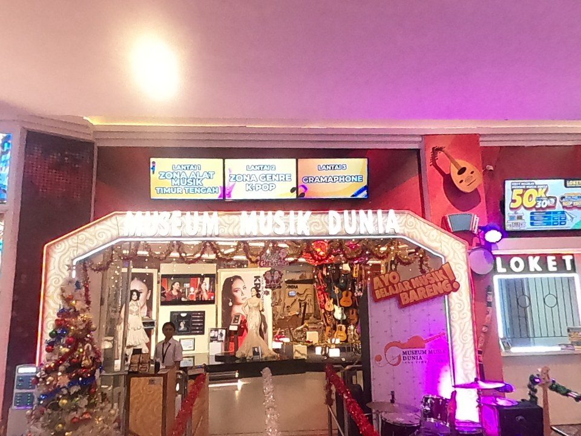

# Museum Musik Dunia 360° - Tur Virtual Web VR

Aplikasi tur virtual 360° berbasis web (WebVR / WebXR) untuk menjelajahi tiga lantai **Museum Musik Dunia** di kawasan Jawa Timur Park 3, Kota Batu. Pengunjung dapat menyusuri rute ruang pamer secara berurutan, memeriksa foto detail koleksi, serta mendengarkan sampel suara berbagai alat musik tradisional dan modern langsung dari peramban desktop, ponsel, maupun perangkat headset VR.



## Cakupan Rute & Koleksi

Seluruh rute disusun menyambung mengikuti alur jalan kaki pengunjung dari gerbang depan hingga ruang konser lantai teratas (**25 titik panorama**, **42 panel informasi koleksi**, dan **32 sampel audio instrumen**):

| Lantai | Tema Zona | Jumlah Titik | Koleksi Unggulan |
| :--- | :--- | :---: | :--- |
| **Lantai 1** | Instrumen 5 Benua & Nusantara | 12 titik (20 info) | Gerbang Utama, Zona Diva Nasional, Pohon Gitar, Pipe Organ 1899, Harpa Konser, Drum Set Terry Bozzio, Instrumen Afrika, Amerika Latin, Timur Tengah, India, Didgeridoo, Tiongkok, dan Gamelan Nusantara |
| **Lantai 2** | Sejarah Genre & Memorabilia Musisi | 10 titik (18 info) | Keroncong Kampung Tugu, Gesang, Koes Plus, Gombloh, Dara Puspita, God Bless, Chrisye, Nike Ardilla, Elvis Presley, Michael Jackson, The Beatles, Panggung Jazz, dan Gitar Elektrik |
| **Lantai 3** | Musik Klasik & Kotak Musik Antik | 3 titik (4 info) | Ruang Konser Grand Piano, Deretan Upright Piano Klasik Eropa, Fonograf & Gramofon Antik, serta Koleksi Kotak Musik Mekanik (*Music Box*) |

## Fitur Utama

- **Navigasi Panorama 360° Berantai:** Berpindah antar-ruangan langkah demi langkah melalui hotspot panah emas di permukaan lantai, tombol `Maju` / `Mundur` pada panel kiri, pintasan lantai di bagian bawah, atau melompat ke ruangan mana pun lewat menu **Daftar Ruangan**.
- **Panel Informasi Koleksi (2D & 3D VR):** Sebanyak 42 titik informasi menampilkan foto detail koleksi proporsional (`4:3`) tanpa terpotong beserta penjelasan kuratorial, baik melalui dialog 2D maupun papan 3D di dalam mode headset VR.
- **Pemutar Suara Instrumen Musik:** Sebanyak 32 koleksi alat musik dilengkapi sampel rekaman suara asli dengan kontrol `Putar Suara` / `Jeda Suara`, penggeser durasi waktu, tombol `Ulang`, dan penghentian otomatis saat jendela ditutup atau pengguna berpindah titik.
- **Dukungan Headset VR (WebXR):** Mendukung interaksi pengontrol tangan (`laser-controls` kiri/kanan) maupun kursor tatap otomatis (*gaze-fuse* 1,4 detik) untuk perangkat VR tanpa pengontrol fisik.
- **Mode Tampilan Bersih & Kontrol Kamera:** Menyediakan tombol **Sembunyikan Menu** agar seluruh antarmuka HUD terlipat saat menikmati panorama penuh, mode **Layar Penuh**, pengaturan *zoom* (`-`, `1.0x`, `+`, serta roda *mouse*), dan tombol jeda animasi hotspot.

## Kontrol & Pintasan

| Interaksi / Tombol | Fungsi |
| :--- | :--- |
| **Geser klik kiri / sentuh layar** | Memutar sudut pandang kamera 360° ke segala arah |
| **Roda *mouse* / tombol `-` `1.0x` `+`** | Mengatur perbesaran tampilan kamera (*Field of View*) |
| **Hotspot panah emas / `Maju` & `Mundur`** | Melangkah ke titik panorama berikutnya atau sebelumnya |
| **Ikon `i` biru / daftar koleksi di kiri** | Membuka foto detail, deskripsi benda pameran, dan sampel suara |
| **Tombol `H` (Keyboard)** | Menyembunyikan atau menampilkan kembali seluruh panel menu (HUD) |
| **Tombol `F` (Keyboard)** | Mengaktifkan atau keluar dari mode layar penuh (*Fullscreen*) |
| **Tombol `Esc` (Keyboard)** | Menutup dialog informasi koleksi atau daftar ruangan |
| **Tombol `VR` (kanan bawah)** | Masuk ke mode stereoskopik WebXR dengan pengontrol laser atau kursor tatap |

## Struktur Proyek

```text
vr-museum/
|-- index.html       # Dokumen utama HTML, overlay antarmuka 2D, modal info, dan adegan A-Frame
|-- README.md        # Dokumentasi proyek
|-- css/
|   `-- style.css    # Styling responsif, tata letak HUD, dialog modal, dan kontrol pemutar audio
|-- js/
|   |-- data.js      # Basis data 3 lantai, 25 titik panorama, sudut arah jalan, 42 info, dan 32 audio
|   `-- app.js       # Logika navigasi 360°, sinkronisasi HUD/VR, kamera/zoom, serta manajemen audio
|-- img/             # 25 panorama equirectangular bersih (GS__*.JPG), thumbnail, dan foto detail koleksi
`-- audio/           # 32 berkas sampel suara instrumen musik berformat MP3
```

## Cara Menjalankan secara Lokal

Karena A-Frame memuat tekstur panorama ke dalam kanvas WebGL (`<a-sky>`), jalankan proyek melalui server HTTP lokal agar peramban tidak memblokir pemuatan aset akibat kebijakan CORS `file://`:

1. **Menggunakan ekstensi VS Code Live Server**
   - Buka folder proyek di Visual Studio Code.
   - Klik kanan pada berkas `index.html`, lalu pilih **Open with Live Server**.

2. **Menggunakan Python**
   ```bash
   python -m http.server 8080
   ```
   Kemudian buka `http://localhost:8080` di peramban.

3. **Menggunakan Node.js**
   ```bash
   npx serve .
   ```
   Kemudian buka alamat lokal yang ditampilkan pada terminal.

## Teknologi & Kredit Aset

- **Kerangka Kerja WebVR:** [A-Frame 1.6.0](https://aframe.io/) berbasis HTML5, CSS3, Vanilla JavaScript, WebGL, dan WebXR Device API.
- **Fotografi Panorama & Koleksi:** Dokumentasi lapangan ruang pamer Museum Musik Dunia, Jawa Timur Park 3, Kota Batu.
- **Sampel Audio Instrumen:** Rekaman audio instrumen berlisensi terbuka (Domain Publik dan Creative Commons) dari Wikimedia Commons.
